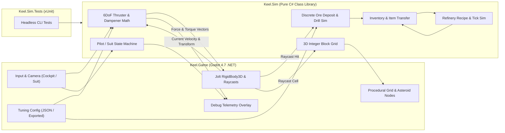

# Architecture — Keel

## Goals

- Prove the core space-construction loop (fly 6DoF ship, exit in zero-g suit, drill discrete ore, refine on a station, place one structural block on the station grid) inside a 20 km bubble.
- Maximize what a coding agent can verify headlessly via fast, deterministic CLI unit tests before a human launches the engine to judge feel.
- Keep all flight, suit, and drill feel parameters tunable outside compiled code, paired with an always-on in-game telemetry overlay.

## Constraints

- **Agent-authored codebase:** Scenes, assets, and logic must be plain text and statically typed where possible so the agent catches errors at compile and test time rather than inside the editor.
- **No agent playtesting:** The agent cannot judge 6DoF flight or drill feel. Will tunes feel on the target Windows PC (RTX 3090, 64 GB RAM).
- **Official engine build only for the slice:** Avoid custom C++ engine compilation (no `precision=double` and no Zylann Voxel Tools module in the first slice). Keep play inside 20 km of the origin.
- **User workspace rule:** Do not auto-launch long-running dev servers from the agent; CLI test execution (`dotnet test`) must run without starting the Godot editor.
- **Lean test suite (no testing the obvious):** Unit tests cover non-trivial math, state transitions, and failure recovery only—never constants, design tokens, trivial boolean toggles, simple DTOs, or compiler-enforced types.

## Approaches considered

### 1. Godot 4.7 (.NET / C#) with headless `Keel.Sim` and thin `Keel.Game`
Split the codebase into a pure C# simulation library (`Keel.Sim`, zero Godot dependencies) and a thin Godot presentation/physics assembly (`Keel.Game`). Build scenes primarily from C# code rather than deeply nested `.tscn` files.
- **Trade-off:** Requires the .NET SDK and Godot .NET editor build, and C# compilation is slower than GDScript hot-reload. In return, static types, fast loop performance for grids/inventories, and millisecond `dotnet test` runs catch agent mistakes before the game opens.

### 2. Godot 4.7 with GDScript
Write both simulation and presentation in GDScript using standard Godot scenes and resources.
- **Trade-off:** Instant script reload and zero .NET toolchain setup, but weaker static typing, slower array/grid loops, and tests require running the Godot binary headlessly.

### 3. Rust + Bevy (or Unreal Engine 5 C++)
Use a code-first ECS in Rust (Bevy) or Unreal 5 with Large World Coordinates.
- **Trade-off:** Bevy is code-only and strongly typed, but has slow compile times, a churn-heavy API, and weak visual tooling for rapid grey-boxing. Unreal 5 gives native double precision and high-end visuals out of the box, but binary Blueprints/assets and heavy C++ build times work poorly with coding agents.

## Recommended approach

**Approach 1: Godot 4.7 (.NET / C#) with headless `Keel.Sim` and thin `Keel.Game`.**
The deciding factor is **agent verifiability with a human fallback**: `Keel.Sim` lets the agent prove 6DoF flight kinematics, inertial dampeners, grid placement rules, mining yields, and refinery recipes via `dotnet test` in under a second, while Will can read C# directly and tune exported config values in Godot.

## Stack

- Language: C# (.NET 10 SDK)
- Framework: Godot 4.7 (.NET official editor build) + Jolt Physics 3D (default)
- Database: In-memory state + JSON config files (no persistence in first slice)
- Tests: xUnit via `dotnet test Keel.sln`
- Deploy: Local Windows PC (x64)

## Shape of the system

- **`src/Keel.Sim` (`net8.0` class library):** Pure C# with no reference to `GodotSharp`. Owns:
  - `FlightKinematics`: Given a 6DoF input vector, current linear/angular velocity, inertial dampener toggle, and tuning config, outputs local force and torque vectors and speed-clamped states.
  - `PilotModeStateMachine`: Tracks whether the player is `SeatedInCockpit` or `FloatingInSuit`, handling entry/exit transitions and spawning offsets.
  - `OreDeposit` & `DrillSim`: Tracks discrete ore node health/remaining yield and converts drill time into ore items in an `Inventory`.
  - `Inventory` & `RefinerySim`: Fixed-slot/mass inventory and tick-based conversion of raw ore into structural blocks.
  - `BlockGrid`: Sparse 3D integer coordinate grid (`Int3 -> BlockType`) enforcing adjacency and occupancy rules for stations.
- **`src/Keel.Game` (Godot .NET project):** Thin engine adapter. Reads player input, passes state into `Keel.Sim`, applies returned force/torque vectors to Jolt `RigidBody3D` bodies, raycasts for drilling and block placement, synchronizes `BlockGrid` cells to Godot `MeshInstance3D` / `StaticBody3D` children, hot-reloads `tuning.json`, and renders the on-screen debug overlay.
- **`tests/Keel.Sim.Tests` (`net8.0` xUnit project):** Deterministic unit tests covering all `Keel.Sim` modules.
- **Exposure:** Local only — no network or auth surface.

## Data

- **`Int3` / `Vec3` (`Keel.Sim`):** Value types in `Keel.Sim` (or `System.Numerics.Vector3`) so simulation math never depends on `Godot.Vector3`.
- **`TuningConfig`:** Plain C# record loaded from `config/tuning.json` (with file-watcher hot reload) holding ship mass, linear/angular thrust, dampener strength, suit thrust, mouse sensitivity, drill range, drill rate, and refinery conversion time.
- **`BlockGrid`:** Dictionary of `Int3` cell coordinates to `BlockType` (`Core`, `Refinery`, `ArmorBlock`), with cell size `2.5m` (station scale).
- **`Inventory`:** Map of `ItemId` (`IronOre`, `SteelBlock`) to integer quantity and capacity limit.
- **`RefineryState`:** Input `Inventory`, output `Inventory`, active recipe progress timer, and conversion ratio.
- **`OreDepositState`:** Discrete deposit ID, `ItemId`, remaining ore units, and extraction progress.

## Key decisions

- **Pure C# `Keel.Sim` decoupled from `GodotSharp`** (Rejected: putting simulation logic in Godot `Node` scripts). Lets `dotnet test` run without Godot installed or running, and keeps simulation deterministic. See [ADR 0001](../adr/0001-engine-free-keel-sim-assembly.md).
- **6DoF flight and dampener math in `Keel.Sim`, integration in Jolt `RigidBody3D`** (Rejected: computing thrust and dampeners directly inside Godot `_IntegrateForces`). Makes counter-thrust, deadzones, and speed limits unit-testable. See [ADR 0001](../adr/0001-engine-free-keel-sim-assembly.md).
- **Seated-or-suit player state only** (Rejected: walking inside a moving ship interior). Avoids moving-reference-frame physics bugs in the first slice.
- **Discrete ore deposits instead of voxel asteroids** (Rejected: Zylann Voxel Tools C++ module). Avoids custom engine builds and C# binding friction while proving the mining loop.
- **Single-precision coordinates inside a 20 km bubble** (Rejected: compiling Godot from source with `precision=double`). Keeps the official Godot .NET editor binary for the first slice.
- **Code-built scenes over heavy `.tscn` files** (Rejected: authoring complex node trees in `.tscn`). Prevents agent formatting errors in Godot text scene serialization.

## Risks and spikes

- **Risk — Flight and suit feel may be flat or disorienting in grey-box space:** No visual reference points in empty space make 6DoF inertia hard to read. Mitigated by the debug velocity vector overlay, space dust / reference asteroid field, and live `tuning.json` reload.
- **Spike (before Phase 1 build) — Verify .NET 8 SDK + Godot 4.7 .NET CLI toolchain on the dev machine (Time box: 30 minutes):**
  - *Question:* Are the `.NET 8 SDK` and `Godot 4.7 .NET` console executable installed and reachable on PATH so `dotnet test Keel.sln` runs cleanly? (Currently `dotnet --version` reports no SDK installed.)
  - *Impact:* Must be installed before Stage 6 (`/sdlc:build-epic`) can run red-green-refactor.

## Open questions

- When the playable space expands beyond 20 km in a later phase, do we implement a floating origin in `Keel.Game` or maintain a custom `precision=double` Godot .NET build?
- Does ship construction (Phase 2+) share the exact `BlockGrid` type as stations by attaching a dynamic `RigidBody3D` and summing mass/thrusters from grid blocks?
